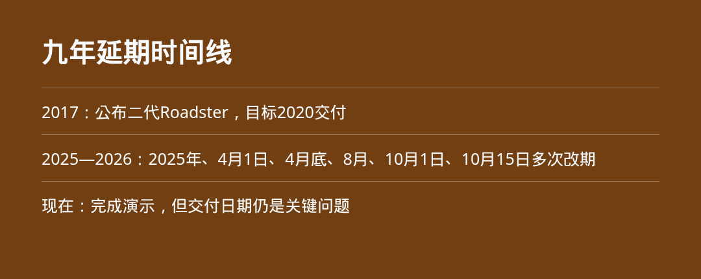
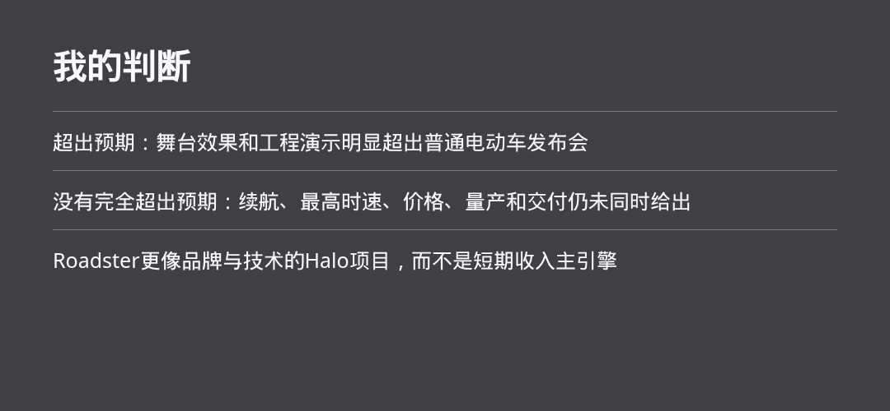

Tesla这场 **Roadster** 发布会给出了罕见的现场答案：车辆完成了飞跃、翻转和落地，马斯克还展示了约 **1秒完成0—60英里/小时** 的说法。它在舞台效果上明显超出普通电动车发布会，但真正决定产品价值的 **价格、续航、道路合规、量产和交付时间** 仍没有被一次性讲清楚。

> 北京时间10月16日，Tesla Roadster在德州演示飞跃、翻转和受控落地；这是一次强烈的工程展示，但还不是交付承诺。

## 发布会表现

TechCrunch对现场演示的报道显示，Roadster使用风扇和推进器完成了上坡、翻转并落回地面，还越过了 **Cybercab、Cybertruck、Tesla Semi、Model Y和Model 3**。马斯克称这会是“真正上路的车”，并展示了约 **1秒破百** 的性能说法。[TechCrunch](https://techcrunch.com/2026/10/15/tesla-reveals-spacex-powered-roadster-that-flies-and-falls-with-style/)

这次表现比2017年只展示静态概念车更进一步：观众看到的是一辆能完成复杂动作的实车或工程演示车。但需要把“现场完成动作”和“普通消费者可以合法、稳定地使用”分开，发布会本身没有证明后者。

## 是否超出预期

**超出预期的部分** 是演示本身。此前市场已经知道Tesla会讲SpaceX推进器，但真正出现飞跃、翻转和落地，仍然比“展示一辆更快的电动跑车”更戏剧化，也解释了为什么发布会必须在户外举行。

**没有完全超出预期的部分** 是产品化信息。发布会报道重点放在演示和品牌效果上，仍没有同时给出足够清晰的 **最终售价、续航、最高时速、量产工厂、交付月份和道路使用限制**。因此我的判断是：这场发布会在营销和工程想象力上超预期，在投资者最关心的可交付性上仍然留有很大折扣。

## 使用了哪些技术

- **SpaceX冷气推进器**：报道提到选装方案约有 **10个小型火箭推进器**，用于短时推力和姿态控制。[TechCrunch](https://techcrunch.com/2026/10/15/tesla-reveals-spacex-powered-roadster-that-flies-and-falls-with-style/)
- **风扇与推进器协同**：现场动作不是单纯依靠轮胎加速，而是由高功率风扇和推进器共同完成飞跃、翻转和受控下降。[TechCrunch](https://techcrunch.com/2026/10/15/tesla-reveals-spacex-powered-roadster-that-flies-and-falls-with-style/)
- **高性能电驱和电池系统**：2017年公布过 **1.9秒破百、超过250英里/小时、约620英里续航** 等目标，但这些是早期目标，不能自动视为本次量产车参数。[Tesla Roadster官网](https://www.tesla.com/roadster)

关键技术难点不只是“能不能飞”，而是推进器储气、车重、噪声、安全距离、法规认证、维护成本和普通道路使用边界。**现场能完成一次动作，不等于已经完成量产工程。**

## 历史延期记录

- **2017年11月**：Tesla在Semi活动末尾公布第二代Roadster，最初目标是 **2020年交付**。[Electrek](https://electrek.co/2026/10/13/tesla-roadster-event-thursday-nine-years-delays/)
- **2021年**：SpaceX套件和更快加速目标被继续提出，产品时间表仍未落地。
- **2024年**：马斯克称设计目标大幅提高，并把生产预期推向 **2025年**；随后仍未交付。[TechRadar](https://www.techradar.com/vehicle-tech/hybrid-electric-vehicles/long-term-the-only-manually-driven-car-will-be-the-tesla-roadster)
- **2025年11月**：Tesla将生产版展示目标定到 **2026年4月1日**。[TechCrunch](https://techcrunch.com/2025/11/06/tesla-delays-reveal-of-production-roadster-2-to-april-fools-day/)
- **2026年**：时间点又经历4月底、约一个月后、8月、10月1日，最后因天气改到 **10月15日**。[Electrek](https://electrek.co/2026/09/28/tesla-roadster-event-october-15-weather/)

这段历史改变了评价标准：Roadster现在不需要再证明Tesla会做一个惊艳概念，但必须证明 **这次演示对应一条可执行的量产路线**。

## 我的判断

我认为这次发布会对Tesla的品牌叙事是加分项，对短期收入的意义却有限。Axios此前援引分析师观点称，Roadster更像品牌展示而不是收入主引擎；这与Tesla长期把它定位成光环车型的说法一致。[Axios](https://www.axios.com/2026/10/14/tesla-roadster-details-elon-musk)

接下来最重要的不是继续争论“飞行汽车”这个标题，而是看Tesla是否公布 **最终规格、价格、认证边界、生产地点和首批交付时间**。如果这些信息继续缺席，发布会越震撼，延期风险和执行折价反而越值得重视；如果后续给出明确量产节点，Roadster才可能从一次成功的演示变成真正的产品信号。

## 会碰到的公司

- **Tesla（TSLA）**：直接承担Roadster的研发、量产和品牌回报。
- **SpaceX**：推进器技术和测试场景与SpaceX有关，但两家公司之间的具体供应、合规和商业安排仍应以正式文件为准。
- **Rimac、Pininfarina、Lucid、BYD、小米**：高性能电动车竞争已经存在，Roadster的性能优势最终要用可交付规格和实测结果比较，而不是只看舞台演示。[T3](https://www.t3.com/auto/electric-vehicles/what-to-expect-from-the-extremely-delayed-tesla-roadster-launch)

## 来源

来源：Tesla Roadster官网、TechCrunch、Axios、Electrek、TechRadar、T3。本文区分了现场演示、公司说法、历史目标和作者判断。

本文为公开资讯整理，不构成投资建议。
