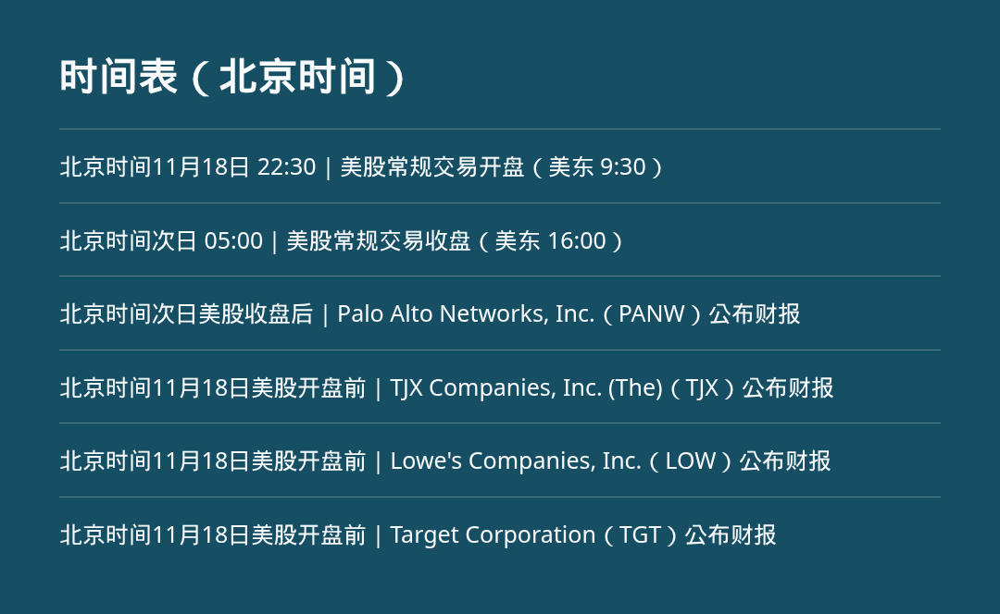
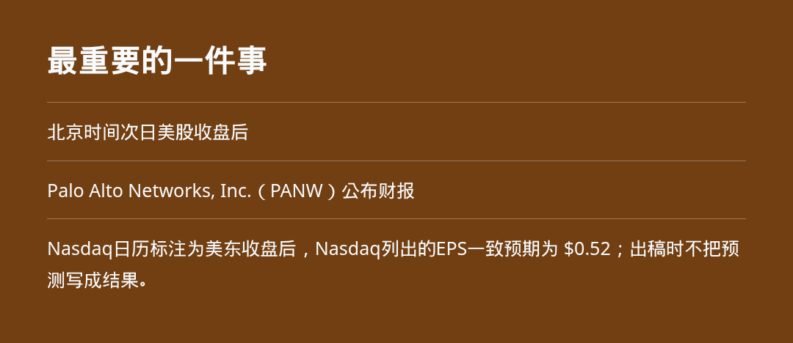
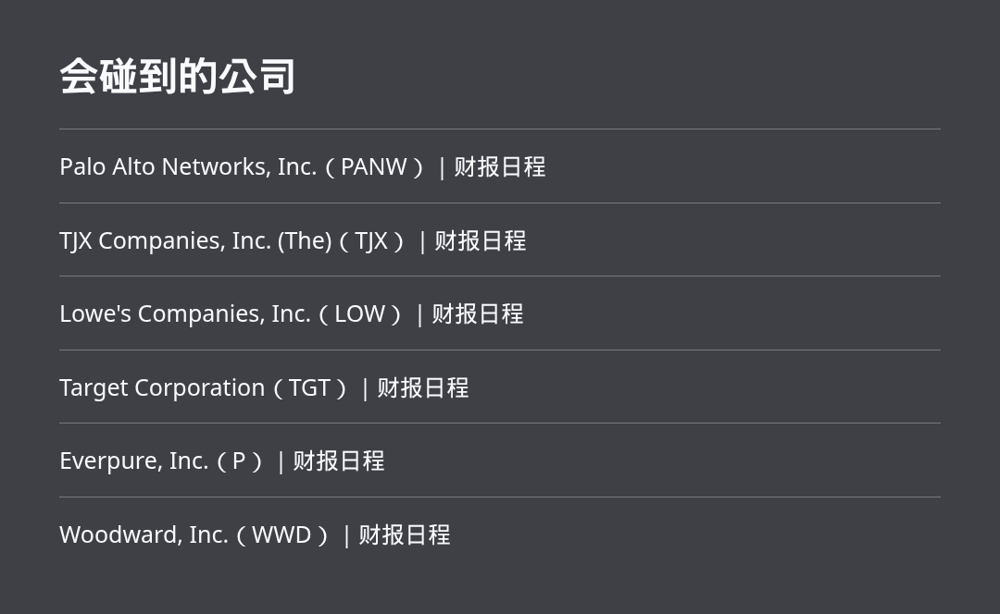

接下来先看Palo Alto Networks, Inc.（PANW）财报。同一窗口还有美股开盘和收盘。相关时间会碰到科技股、利率预期、黄金和比特币，但出稿时没有结果。

> 北京时间次日美股收盘后，Palo Alto Networks, Inc.（PANW）公布财报。这是出稿时已经核对、但尚未发生的事项。

## 时间表

- 北京时间11月18日 22:30：**美股常规交易开盘（美东 9:30）**。这是交易时段开始，不代表已经发生涨跌。
- 北京时间次日 05:00：**美股常规交易收盘（美东 16:00）**。出稿时尚未发生，只写成将要收盘。
- 北京时间次日美股收盘后：**Palo Alto Networks, Inc.（PANW）公布财报**。Nasdaq日历标注为美东收盘后，Nasdaq列出的EPS一致预期为 $0.52；出稿时不把预测写成结果。
- 北京时间11月18日美股开盘前：**TJX Companies, Inc. (The)（TJX）公布财报**。Nasdaq日历标注为美东开盘前，Nasdaq列出的EPS一致预期为 $1.33；出稿时不把预测写成结果。
- 北京时间11月18日美股开盘前：**Lowe's Companies, Inc.（LOW）公布财报**。Nasdaq日历标注为美东开盘前，Nasdaq列出的EPS一致预期为 $2.86；出稿时不把预测写成结果。
- 北京时间11月18日美股开盘前：**Target Corporation（TGT）公布财报**。Nasdaq日历标注为美东开盘前，Nasdaq列出的EPS一致预期为 $2.05；出稿时不把预测写成结果。
- 北京时间次日美股收盘后：**Everpure, Inc.（P）公布财报**。Nasdaq日历标注为美东收盘后，Nasdaq列出的EPS一致预期为 $0.27；出稿时不把预测写成结果。
- 北京时间次日美股收盘后：**Woodward, Inc.（WWD）公布财报**。Nasdaq日历标注为美东收盘后，Nasdaq列出的EPS一致预期为 $2.50；出稿时不把预测写成结果。

## 最重要的一件事

北京时间次日美股收盘后，**Palo Alto Networks, Inc.（PANW）公布财报**。Nasdaq日历标注为美东收盘后，Nasdaq列出的EPS一致预期为 $0.52；出稿时不把预测写成结果。公司自己的宣传数字如果后续出现，必须等原始发布后再核对；出稿时不把预测写成结果。

## 我的判断

- 重点看 **Palo Alto Networks, Inc.（PANW）** 的实际结果是否偏离 Nasdaq 一致预期；在结果公布前，预期只能作为观察基准，不能当成事实。
- 这批公司集中在财报窗口，若指引或管理层表述变化，影响通常会先传导到同业和风险偏好，再影响黄金、比特币等利率敏感资产；本文不预判涨跌方向。

## 数据和利率

出稿时只保留窗口内已经核对的公开日程。窗口内没有从美国联邦储备委员会和美国劳工统计局日历核对到的临时数据或讲话，因此不编造公布数字或市场概率。下一场议息会议是 **美联储官方日历尚未列出下一场会议**，不是今天。今晚的利率或数据会碰到黄金和比特币，出稿时还没有这场的结果。

## 会碰到的公司

- **Palo Alto Networks, Inc.（PANW）**：财报时间已由 Nasdaq 日历列出，影响要等事件发生后才能判断。
- **TJX Companies, Inc. (The)（TJX）**：财报时间已由 Nasdaq 日历列出，影响要等事件发生后才能判断。
- **Lowe's Companies, Inc.（LOW）**：财报时间已由 Nasdaq 日历列出，影响要等事件发生后才能判断。
- **Target Corporation（TGT）**：财报时间已由 Nasdaq 日历列出，影响要等事件发生后才能判断。
- **Everpure, Inc.（P）**：财报时间已由 Nasdaq 日历列出，影响要等事件发生后才能判断。
- **Woodward, Inc.（WWD）**：财报时间已由 Nasdaq 日历列出，影响要等事件发生后才能判断。

## 来源

来源：[纽约证券交易所交易时段说明](https://www.nyse.com/markets/hours-calendars)、[Nasdaq Earnings Calendar](https://api.nasdaq.com/api/calendar/earnings?date=2026-11-18)、[美联储 FOMC 日历](https://www.federalreserve.gov/monetarypolicy/fomccalendars.htm)。本文写的是尚未发生的日程。

本文为公开资讯整理，不构成投资建议。
